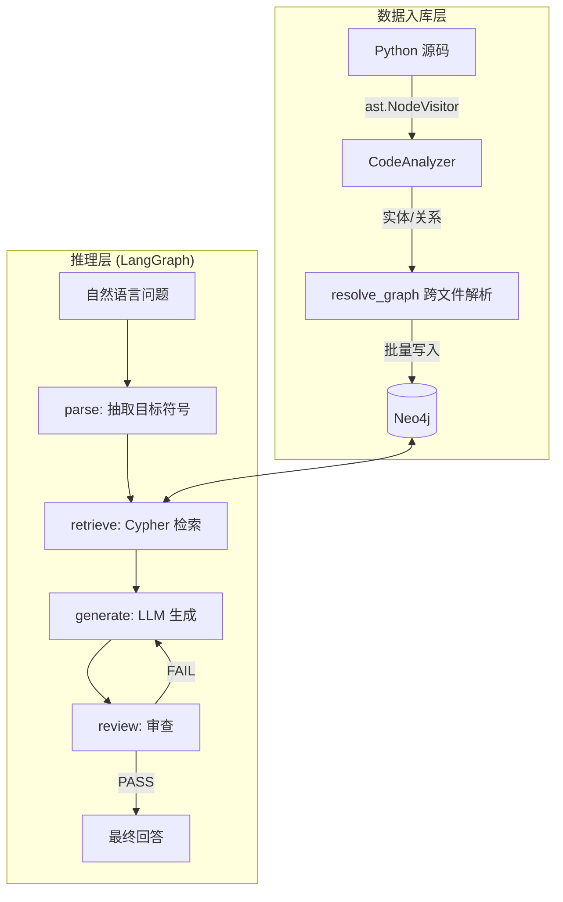

# ✈️ CodeGraph Pilot

[](https://www.python.org/)
[](https://neo4j.com/)
[](#评测)
[](#license)

> **Structure-Aware Code Intelligence** — 把 Python 源码建成代码知识图谱 (CKG),
> 用 Cypher 做确定性影响分析, 并用 LangGraph 编排一个带自我审查的分析 Agent。

## 这个项目解决什么问题

改一个底层函数, 不知道哪些上层业务会崩 —— 这是遗留系统维护的核心痛点。
基于向量相似度的 RAG 只能找到"名字像"的代码, 找不到"逻辑上调用"的代码。

本项目用 **AST 建图 + Cypher 遍历**回答结构问题, 再用 LLM 把图事实翻译成人话。
两条能力是分开的: 图负责"哪些符号有关", LLM 负责"这意味什么风险"。

## ⚠️ 诚实的边界 (先读这段, 再看特性)

这个项目**不是**什么, 和它**还没做到**什么:

| 不声称 | 实际情况 |
|---|---|
| **不是 Code Property Graph (CPG)** | CPG 有精确定义 (Yamaguchi et al. 2014): AST ∪ CFG ∪ PDG。本项目**只有调用图 + 继承边**, 无控制流图、无程序依赖图。准确叫法是 **Code Knowledge Graph (CKG)** |
| **无向量检索 / 无混合检索** | 没有 Vector DB, 没有 embedding。README 早期版本写的"AST+Vector 混合检索"是**不实的**, 已删除。检索 100% 是 Cypher 结构遍历 |
| **不支持 Java/Go** | 仅 Python, 基于标准库 `ast`。多语言需引入 tree-sitter, 未做 |
| **跨文件调用不是全量解析** | 依赖 import 关系 + 名字匹配推断, **不是类型精确的符号解析**。`obj.method()` 会记到 `unresolved_calls` 而不伪造边 |
| **增量更新是批内增量** | `build <dir> --keep` 会先删本批文件的旧子图再写入 (源码里改名/删除的符号不会残留)。但**仍需全量解析该目录**才能解析跨文件调用 —— 单文件级 dirty 检测未做 |
| **LLM 效果未在真实模型上验证** | Agent 的端到端质量依赖 LLM; 仓库内所有测试用假 LLM (见 [评测](#评测)) |

## 架构



图模型 (节点以 `module:qualname` 为 uid, 避免同名跨模块串号):

```
(:Module)-[:IMPORTS]->(:Module)
(:Class)-[:INHERITS]->(:Class)
(:Symbol)-[:DEFINED_IN]->(:Module)
(:Method)-[:BELONGS_TO]->(:Class)
(:Symbol)-[:CALLS]->(:Symbol)      # 仅当能确定解析目标时建立
```

## 核心能力

### 1. 确定性结构分析
不依赖 LLM 做结构提取。`ast.NodeVisitor` 解析出 `Class` / `Function` / `Method`
及其层级, 每个符号带 `filepath` / `lineno` / `module`。

### 2. 双向影响分析
`graph_store.Neo4jGraphStore` 提供结构化查询:
- `symbol(name)` — 定位唯一符号, 返回直接上下游 (失败时返回结构化 `error`, 不抛异常)
- `impact(name, depth)` — **上游传递闭包** (改这个函数最终会影响谁) + 直接下游
- `hierarchy(name)` — 父类链 (`INHERITS` 传递闭包) + 子类 + 类成员 (`BELONGS_TO`)

上游用传递闭包是因为"影响面"必须传递; 下游只取直接依赖, 展开反而稀释重点。

`hierarchy()` 覆盖的语义是 `CALLS` 补不上的: `CALLS` 是运行时依赖,
`INHERITS` 是类型层级。改一个父类方法的影响面, 只用 `CALLS` 会漏掉所有子类。

```bash
uv run python -m codegraph hierarchy AuthService
# auth.service:AuthService  (Class)
# 父类链 (INHERITS): auth.service:BaseService
# 成员 (BELONGS_TO): AuthService.login, AuthService.refresh
```

### 3. 带自我审查的 Agent
`parse → retrieve → generate → review` 四节点循环。审查不通过会重生成 (最多 1 次)。
**审查的有效性是有测量口径的**: 轨迹区分 `terminated_by=pass` 与
`terminated_by=max_revision` —— 旧实现里二者在输出上无法区分, 导致
"自修正有效"这个说法无法被验证。

### 4. 本体约束校验
`src/ontology/` 用 RDFS/OWL 定义 schema (`Function`/`Method`/`Class`/`Module`
及 `CALLS`/`INHERITS` 的 domain/range), 在导出 RDF 后校验。
当前 fixture: **244 triples, 0 违规**, 已验证可检出 4 类真实缺陷
(domain/range 违规、悬空边、重复 uid、BELONGS_TO 主体错误)。

### 5. Agent 可观测性
`src/observability/` 记录每次 run 的轨迹 (JSONL) 并计算:

```
hallucinated       = claimed - retrieved
hallucination_rate = |hallucinated| / |claimed|
grounding_recall   = |claimed ∩ retrieved| / |retrieved|
```

纯集合运算, **不引入 LLM judge** —— 判定"图里没有的东西出现在答案里"可重复、零成本。
三条口径纪律 (由测试守护): 检索失败的 run 不计入均值; 比率按 pooled 汇总;
样本量 < 30 时输出"不得对外宣称"警告 (符号抽取是下界)。

## 快速开始

### 前置要求
Python 3.10+ · Docker · [uv](https://github.com/astral-sh/uv)

### 1. 启动 Neo4j
```bash
docker-compose up -d
# 等待约 20 秒, 访问 http://localhost:7474 确认就绪
# 账号/密码: neo4j / password123
```

### 2. 安装依赖
```bash
uv sync
```

### 3. 配置环境
创建 `.env` (已在 `.gitignore`, 勿提交):

```ini
NEO4J_URI=bolt://localhost:7687
NEO4J_USER=neo4j
NEO4J_PASSWORD=password123
QWEN_API_KEY=sk-...            # 可选: 不填则 LLM 相关功能不可用, 图查询仍可用
QWEN_BASE_URL=https://dashscope.aliyuncs.com/compatible-mode/v1
```

> `.env.example` 尚未提供 —— 请按上面字段手工创建。

### 4. 用 CLI (不需要 LLM Key)

```bash
export PYTHONPATH=src        # 或: uv run python src/codegraph.py <cmd>

# 建图: 解析目录 -> 写入 Neo4j
uv run python -m codegraph build benchmarks/fixtures/webapp_py

# 查符号: 直接上下游
uv run python -m codegraph symbol validate_token

# 影响分析: 上游传递闭包 + 直接下游
uv run python -m codegraph impact validate_token --depth 3

# 本体约束校验 (CI 门禁, 违规即退出码非零)
uv run python -m codegraph validate
```

`build` / `symbol` / `impact` / `validate` **不需要 LLM Key**;
默认连接 `bolt://localhost:7687` (与 `docker-compose.yml` 一致), 未写 `.env` 也能用。

### 5. 跑 Agent (需要 LLM Key)
```bash
uv run python -m codegraph analyze "修改 validate_token 会影响谁"
uv run streamlit run src/app.py        # Web UI
```

### 6. 看指标
```bash
uv run python -m codegraph report              # 汇总轨迹
uv run python -m codegraph report --json       # 机器可读
```

### 命令面 (共 6 条, 对应已实现能力)

| 命令 | 作用 | 需 LLM |
|---|---|---|
| `build <path>` | 解析目录写入 Neo4j | 否 |
| `symbol <name>` | 定位符号, 直接上下游 | 否 |
| `impact <name>` | 传递闭包影响分析 | 否 |
| `analyze <query>` | 跑完整 Agent 工作流 | **是** |
| `report` | 轨迹指标汇总 | 否 |
| `validate` | 本体约束校验 | 否 |
| `mcp` | 启动 MCP 服务 (stdio) | 否 |

### MCP 接入 (给外部 agent 用)

```bash
uv run python -m codegraph mcp
```

只暴露**一个**工具 `codegraph_query`, 用 `action` 分派:

| action | 作用 |
|---|---|
| `symbol` | 定位符号的直接上下游 (最快, 先试这个) |
| `impact` | 传递闭包影响面, `depth` 默认 5 (上限 10) |
| `hierarchy` | 类的父类链 / 子类 / 成员 |
| `overview` | 图概览, 不确定符号名时先调这个 |

为什么只给一个: 竞品 codegraph (73k star) 把 7 个工具默认全部不暴露,
只留一个 `codegraph_explore`, 理由原文是"一个强工具比一堆窄工具更能
引导 agent"。

配置示例 (Cursor / Claude Desktop 的 `mcpServers`):

```json
{
  "code-graph-pilot": {
    "command": "uv",
    "args": ["run", "--directory", "/path/to/code-graph-pilot",
             "python", "-m", "codegraph", "mcp"]
  }
}
```

**错误契约**: 一律返回结构化 JSON, 不抛异常。`{"error": "⚠️ 未找到符号"}`
是**预期内的查询结果**——agent 应据此换个名字重试, 而不是认为工具坏了。
图没建过时先跑 `codegraph build`。

每条命令都支持 `--json` (结构化数据走 stdout, 进度/告警走 stderr,
因此 `codegraph symbol x --json | jq` 干净可用)。

## 评测

**当前只有 fixture 级 benchmark, 不是真实仓库评测。**

| 指标 | 值 | 说明 |
|---|---|---|
| fixture macro recall | **1.000** | 12 个计分场景, 全部满分 (2026-10-14 起) |
| fixture 悬空边 | **0** | 重建前是 64% 的边指向不存在的节点 |
| fixture 图规模 | 26 符号 / 71 关系 | `benchmarks/fixtures/webapp_py` |
| 单元测试 | **209 passed** | 全离线: 不调 LLM, 不联网 |
| 本体违规 | **0** / 244 triples | 见上 |

```bash
uv run python -m benchmarks.runner      # 跑 benchmark, 退出码非零即 recall 倒退
uv run pytest tests/ -q                 # 全量测试
```

### Agent 幻觉率 (真实 LLM, n=30)

同一批 5 个问题各跑 6 轮, 模型 `glm-5-3-flash-260828`:

| 指标 | 值 | 说明 |
|---|---|---|
| 幻觉率均值 | **3.6%** | 中位数 0%, 25/30 轮为 0 |
| grounding recall | **100%** | 模型只引用图谱里已有符号 |
| 残留 3.6% 的构成 | 假设举例 2 + 模块前缀 2 + 检索粒度 1 | 逐条人工审计, **真幻觉 0** |

**这个数字是被审计过的, 不是直接读出来的。** 第一版口径报 81.8%, 接着 30 次
基线报 40.4% —— 但 grounding recall 始终是 100%, 说明模型从未编造符号。
逐条审计 105 个 flagged 符号后确认全部是抽取假阳性: 建议语境故意编的新名
(`validate_token_v2`)、文件路径目录名 (`webapp_py`)、Python 关键字 (`async`)。
按根因修复后降到 3.6%, 残留 4 项经人工确认仍非编造。

教训: **幻觉率是一个需要先审计再相信的指标**。它衡量"抽取器认为模型说了
什么"与"检索给了什么"的差, 不是"模型是否编造"。

**基准口径**: benchmark 打 **recall 不打 accuracy** (见 `docs/decisions/0003-recall-not-accuracy.md`)。
理由: 我们的失败模式是"漏掉调用者"而不是"多报调用者", recall 直接对应重构风险。
`ground_truth` 是人工标注的, 不来自自家工具输出 —— 敢让表格里出现 <100% 是可信度来源。

### 真实仓库评测

fixture 满分不代表真实代码好用。因此在 `psf/requests` 上另跑一套
**只报告事实**的评测 (无 ground truth, 故不称 accuracy):

```bash
uv run python benchmarks/repo_eval.py /path/to/repo
```

| 指标 (requests, 19 文件 / 300 符号) | 值 |
|---|---|
| CALLS 边 | 401 |
| 其中指向真实定义 | **239 (59.6%)** |
| 悬空边 | **0** |
| unresolved 调用 | 296, 其中真漏检 **17** |

296 个 unresolved 里 279 个是**合理的**: 238 个是内置容器方法
(`dict.get` / `str.split`), 41 个是第三方库。分类必须显式做 ——
`requests` 里确实定义了 `get()`, 只按"名字是否被定义过"分会把
33 个 `dict.get` 全部误报成漏检。

真漏检 17 个集中在: 无类型标注的参数 (`prepared_request` 这类由调用方
传入)、跨模块的实例属性 (`self.session`)。这是**已公布的残差**,
不是"解析率 100%"的宣传口径。

## 项目结构

```text
src/
  graph_builder.py    # ast 解析器 + resolve_graph 跨文件解析 + Neo4j 写入
  graph_store.py      # Cypher 收口 + 进程级驱动复用 + GraphStore 协议
  codegraph.py        # CLI 入口 (build/symbol/impact/analyze/report/validate)
  agent.py            # LangGraph 四节点工作流 + 意图符号抽取
  app.py              # Streamlit UI
  observability/      # 轨迹记录 + 指标计算 + 报告 (trace/report/__main__)
  ontology/           # RDFS/OWL schema + 约束校验 (schema/export/validate)
benchmarks/
  fixtures/           # 受控 fixture (auth/tokens/routes/services/utils)
  ground_truth/       # 人工标注的期望结果
  runner.py           # 场景打分
tests/                # 209 个测试, 全离线
docs/
  specs/              # 各模块 spec + capability-map
  decisions/          # ADR (uid 模型、外延桩、recall 口径、Neo4j 保留)
  knowledge/          # 领域调研 + 评测方法论
CONSTRAINTS.md        # 质量契约: 每条规则都点名了判定命令
```

> `src/utils.py` 不存在 (早期 README 误报)。

## 开发约定

- 提交用 Conventional Commits, 中文描述, 带作用域: `feat(core): ...`
- Python 3.10, uv 管理, 4 空格缩进, docstring 用中文
- 改动后必跑: `uv run pytest tests/ -q` 与 `uv run python -m benchmarks.runner`
- **不得为让测试通过而放宽 `CONSTRAINTS.md` 或本体形状**
- 详见 [AGENTS.md](AGENTS.md)

## Roadmap

**未做:** 无。

**已完成 (本轮):**
- [x] MCP 入口 (见上)
- [x] 文件 hash 缓存: `--cache` 只重解析变更文件。**默认关闭** ——
      实测 300 文件解析约 25ms、hash 约 4ms, 小仓库上净亏损,
      只在"文件多、改动少"时才划算。收益未经验证就不进默认路径。

**明确不做 (YAGNI):**
- 多语言 (Java/Go): 需引入 tree-sitter, 与当前目标正交
- 自建 Vector DB: 向量检索不是这个项目的差异点, 补实现不如把结构查询做准
- 多智能体 / 长期记忆: 无证据表明四节点工作流已到瓶颈
- CFG/PDG: 最贵; 做了才配叫 CPG, 在那之前继续用 CKG

## License

MIT
